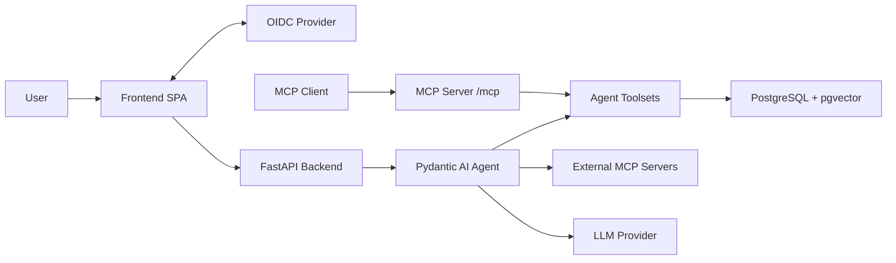
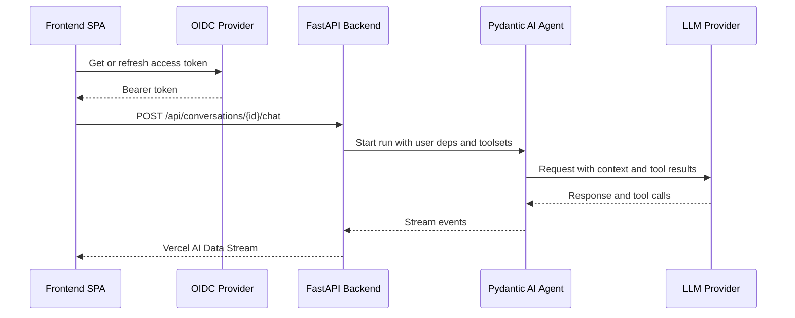
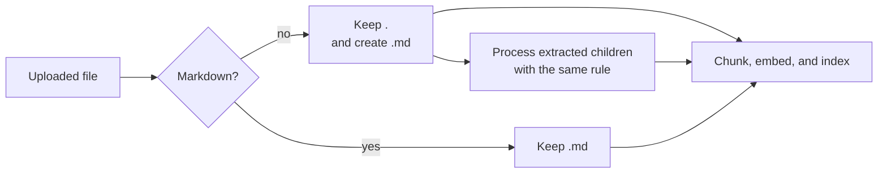

# Architecture

How the pieces fit together, for people working on the code.
The user-facing view is [`docs/src/en/architecture.md`](docs/src/en/architecture.md), the design decisions live in [`backend/README.md`](backend/README.md) and [`frontend/README.md`](frontend/README.md).

Hivegent is a React SPA over a FastAPI service for retrieval-augmented chat over uploaded documents.
The frontend owns authentication, interaction, and local state.
The backend owns execution, storage, security, retrieval, and model integration.

## Frontend

- React 19, Vite, and TanStack Router, with `oidc-spa` for login and mock auth in development.
- Vercel AI SDK for chat streaming, Zustand for client state, TanStack Query for server state, and Zod at the boundaries.
- Tailwind CSS 4 and shadcn/ui on Base UI.

## Backend

- FastAPI exposes authenticated REST, chat streaming, SSE progress, and the MCP endpoint.
- `pydantic-settings` reads configuration from `config.toml`, `HIVEGENT_*` env vars, and credential files.
- Authentication uses OIDC bearer tokens, with groups and roles read from their claims.
- Pydantic AI binds models, user-scoped dependencies, and toolsets into one runtime.
- PostgreSQL with `pgvector` and cbrkit provide dense, sparse, and hybrid retrieval, plus conversations and memory.
- Each user or group workspace lives under `data/workspace/<store_key>/`, keyed by the same `user:<id>` or `group:<id>` token that scopes SQL rows.
- Each conversation owns `data/conversations/<id>/`, outside every workspace.
  Its `tmp/` is the agent's `/tmp`, writable without approval and holding oversized tool results under `/tmp/.tool-results/`.
  Its `changesets/` holds what programs staged for approval.
  The whole folder is swept after one idle TTL (`settings.conversations`, env `HIVEGENT_CONVERSATIONS__*`).
- Every write, edit, move, delete, upload, and new directory is one changeset that `workspace.changeset` plans and commits all or nothing.
  A workspace root carries rows, indexing, and per-item approval, while `/tmp` is written directly within its size cap.
- Each commit is announced once on the job feed as `workspace-changed`, which the SPA follows to refresh its views.
- The MCP server at `/mcp` (`mcp/adapter.py`) serves the agent's `explore`, `write`, and `subagent` toolsets.
  Writes ask for confirmation through MCP elicitation.
- Admins reset data with `POST /api/admin/reset/{target}`, and pipelines are listed at `GET /api/pipelines/{stage}`.

## Integration

- REST for documents, conversations, and settings.
- Vercel AI Data Stream Protocol for chat, Server-Sent Events for job progress and workspace changes.
- Chat configuration (model, reasoning effort, mode, document filters, tools) travels with each chat request.
- The browser language (English or German) is sent as `Accept-Language` on every request.
  It selects the language of backend errors, job titles, and the agent's instructions.

## Agent features

Each feature bundles a toolset with its instructions (`agents/capabilities.py`).
A feature is withheld by its chat mode, by a request's `disabled_tools`, or by `settings.tools.disabled`.

| Feature        | Role                                                        | Tools                                                                                            |
| -------------- | ----------------------------------------------------------- | ------------------------------------------------------------------------------------------------ |
| `explore`      | Read-only access to documents, tables, JSON, and retrieval. | `list_documents`, `read_document`, `read_binary_document`, `query_table`, `jq`, `grep`, `search` |
| `python`       | Monty sandbox, workspace writes are staged as a changeset.  | `run_python`                                                                                     |
| `subagent`     | Delegated exploration in a fresh context.                   | `explore`                                                                                        |
| `write`        | Approved workspace mutation, `/tmp` in every mode.          | `write_document`, `edit_document`, `move_documents`, `delete_documents`, `apply_changes`         |
| `memory`       | Cross-conversation memory, mutating modes only.             | `save_memory`                                                                                    |
| `web`          | Web search and fetch, off unless `tools.enable_web`.        | `web_search`, `web_fetch`                                                                        |
| `conversation` | Conversation history, disabled by default.                  | `list_conversations`, `get_conversation`                                                         |
| `ask`          | Multiple-choice questions for the user.                     | `ask_user`                                                                                       |

## Asset processing

Every upload follows one recursive, stem-based rule.
Markdown stays `<stem>.md`.
Any other file keeps its original `<stem>.<ext>` and gains a markdown companion `<stem>.md`.
Extracted children land in `<stem>.assets/` and are processed the same way.
The app shows one entry per stem and indexes the markdown companions.
Generated image descriptions are never chunked (pipeline `none`).

Which files become entries on their own is described in [`backend/README.md`](backend/README.md#what-becomes-a-document).
