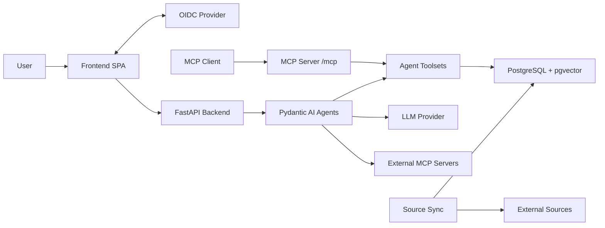
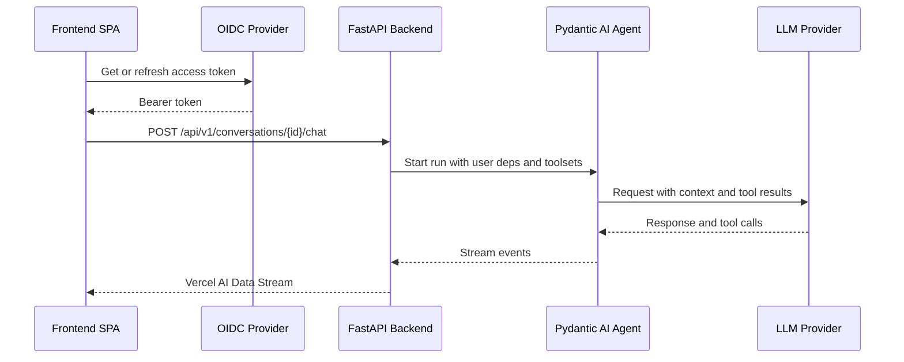
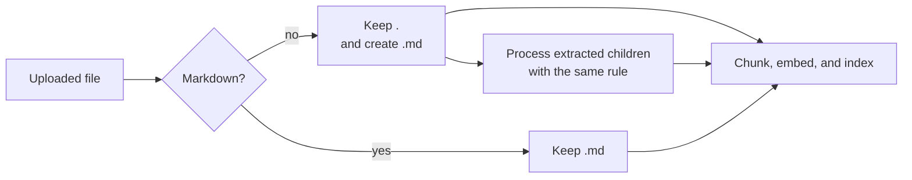

# Architecture

How the pieces fit together, for people working on the code.
The user-facing view is [`docs/src/en/architecture.md`](docs/src/en/architecture.md), the design decisions live in [`backend/README.md`](backend/README.md) and [`frontend/README.md`](frontend/README.md).

Hivegent is a React SPA over a FastAPI service for retrieval-augmented chat over uploaded documents.
The frontend owns authentication, interaction, and local state.
The backend owns execution, storage, security, retrieval, and model integration.

## Frontend

- React 19, Vite, and TanStack Router, with `oidc-spa` for login, mocked when the public `/api/v1/config` names no OIDC client.
- Vercel AI SDK for chat streaming, Zustand for client state, TanStack Query for server state, and Zod at the boundaries.
- Tailwind CSS 4 and shadcn/ui on Base UI.

## Backend

- FastAPI exposes authenticated REST, chat streaming, SSE progress, and the MCP endpoint.
- `pydantic-settings` reads configuration from `config.toml`, `HIVEGENT_*` env vars, and credential files.
- `hivegent serve` always authenticates and refuses to start without `auth.issuer`, for the API and `/mcp` alike.
  Only `hivegent dev`, which the dev stack runs on the loopback address, acts as a development user for every request and refuses an issuer, so the NixOS module and the container, which run `serve`, never have that user.
- Authentication uses OIDC bearer tokens, with groups and roles read from their claims, whose audience names one of the exact client ids in `auth.audience`.
- A token of `auth.service_client_id`, the Teams bridge, is a service principal: it sees the global workspace alone, runs in read mode, is offered no memory or conversation tools, and reaches only the chat route.
- One verifier (`auth.authenticate`) checks every token of the API, its streams, and `/mcp`, an asymmetric signature of the configured issuer with `exp` and `iat` on an access token naming its client, and a stream ends when its token expires.
- One uvicorn process serves the API, so the admission of every request, the maintenance gate and a request bucket for the API and `/mcp` alike, and per-user rate limits on the costly routes are token buckets in memory (`server.rate_limit`), forgetting a bucket once it refilled, while the unfinished upload jobs and spooled bytes of a user are bounded by `jobs.max_owner_jobs` and `jobs.max_owner_spool_bytes` and refused with 429.
- Operator endpoints are `OperatorUrl`s only the settings mint, and the direct client opened for them reaches their origins alone (`http_client`).
  Neither it nor the shared web client keeps cookies, since each serves every caller.
- The admin debugging consoles exist only with `debug.enable`, and their chat debugger reads only the caller's own conversations.
- Pydantic AI binds models, user-scoped dependencies, and toolsets into one agent, and each chat turn is one native run of it, streamed by pydantic-ai's Vercel adapter, as the root of an exar run whose trace holds the spans of pydantic-ai, instrumented into exar's tracer provider, which Logfire only adds exporters to.
  The main agent delegates to its subagents with the `SubAgents` and `TaskControl` of pydantic-ai-harness (`agents/subagents.py`), in the foreground of a call or in the background, steers, cancels, or resumes them within the turn, and the turn waits for the running ones before it ends.
  The subagents share the turn's deps and usage, so the turn's usage limits bound them all together.
  A subagent never asks the user: a call that would ask is denied, so the main agent makes that change itself.
  Shortly before its timeout a subagent is told to report what it found, so it ends with its findings rather than the harness's timeout note, and past that deadline it keeps its tools and instructions while its further tool calls are refused with a "report now" result (`ReportDeadline`).
  A report longer than `llm.tool_output_max_chars` is cut with the whole text saved under `/tmp/.tool-results/`.
  Every step of a subagent renders under the call that delegated to it: the chat stream maps the harness's task events to that call, and only these steps are stored on the call's return, never the subagent's history, so a subagent that timed out or was cancelled keeps the steps it got to, and the transcript renders from them at the end of the turn and on reload (`agents/transcripts.py`, `backend/README.md`, Subagents are delegated to with pydantic-ai-harness).
- A history the context window refused is compacted by `exar.pydantic_ai.compaction`, the summary asked as the next turn under the run's own prefix (`agents/compaction.py`) so the provider's prompt cache answers for it.
- `tools` is a self-contained package, importing only itself and the `shared` package, which imports only itself, as an AST test enforces, while the app hands it what needs it (settings, the executor of the decoders).
- Tools are plain typed async functions with exar's conventions (`exar.tools`: `effect`, `Retry`, `run_batch`, the formatting helpers), each built per run by a factory over the run's deps (`agents.common.AgentTools`) and served to pydantic-ai by `exar.pydantic_ai.toolset` under the host's policy, which one `exar.pydantic_ai.EffectGate` per agent (`guards.HOST_GATE`) applies to every tool call, plugin and external MCP tools included.
  `grep`, `jq`, `list_documents`, `read_document`, and `read_binary_document` are exar's configurable tools (`exar.tools.files`, `exar.tools.media`) bound to the workspaces as `exar.memory.mounts.Mount`s, which they read per call from the run (`UserDeps.mounts`), and the binaries they run (`rg`, `jq`) go through exar's `exar.subprocess`.
  A tool returns a pydantic-ai `ToolReturn`, its text for the model and its typed data in `metadata` for the client and the sandbox, which hands that data to programs (`tools/monty.py`).
- Ingestion is exar's (`exar.ingest`): its parsers, chunkers, media decoders, and worker executors, while Hivegent keeps the glue and the sources, their connectors, WebDAV, and sync planning (`sources/`).
  Converters and chunkers register under string ids in registries the app merges at import (`pipelines`), built-in ones wrapping exar's, app-side, and plugin ones alike, configured by the operator's options for their fields.
  Conversions and the `semantic` chunker run in worker processes, while the cheap chunkers, which load no model, run in a thread of the server, so they never queue behind conversions.
- Plugins are Python packages advertising `hivegent.plugins` entry points, loaded only when `plugins.enabled` names them, which contribute features, converters, chunkers, and skill directories through the facade `plugins.api`, every id unique among Hivegent's and every plugin's and every tool declaring its `Effect`.
- Run state that changes during a conversation, the date and the mode among it, is an instruction whose changes are appended to the history rather than rewriting the instructions, which keeps the provider's prompt cache valid, so the prompt prefix of a conversation survives midnight.
  Changing mode, tools, assistant, model, or language between turns changes it by design, and so does an outage of an external MCP server, which changes the tool list.
  A conversation stores its system prompt once (`conversations.instructions`) and its requests without it.
- PostgreSQL with `pgvector` and cbrkit 2 (its async `Pgvector` storage, embedders through Pydantic AI or sentence-transformers, and `Rerank`) provide dense, sparse, and hybrid retrieval, plus conversations and memory.
  The chunks a caller may read and each person's memory page are exar memories over cbrkit storages scoped by SQL to them (`retrieval.document_memory`, `db.memory.user_memory`).
- A table, JSON, or BPMN file or folder is a case base that `similar_cases` and the document dialog rank by example with cbrkit, by attribute or by graph mapping, configured by what cbrkit infers from its data in memory (`tools.cases`, `cases.py`).
  Every file that belongs to another one, a description, an original, an `.assets` payload, or a cbrkit companion of a case base (sidecar, cache, lock), is derived from its subject by one relation (`tools.entries.Part`), so every move, delete, upload, listing, sync, and import carries them consistently by construction.
  A cbrkit companion is never indexed, loaded as a case, written, imported, or mirrored, and the `<name>.cbrkit.json` sidecar is not read while the format of cbrkit's specifications still evolves, so no configuration is persisted.
  The tree marks what cbrkit's `io.is_casebase` accepts, and `retain_cases` and `maintain_case_base` plan with cbrkit and land the changed files as a changeset whose approval shows cbrkit's reason for every change.
- Conversations are kept by a pydantic-ai `ConversationStore` on PostgreSQL (`db.conversations.PostgresConversationStore`), whose records name each conversation's active history, its branches, the calls a paused run awaits, and its usage.
- Everything owned is owned by one scope, `global`, `group:<id>`, or `user:<id>` (`store.Scope`), and `User.scopes` alone answers which ones a principal sees, in that order.
- Each workspace lives under `data/workspace/<store_key>/`, keyed by its scope's token, which also keys its `workspaces` row, the parent of its documents, which goes with its user, group, or source, or with a wipe of the workspace.
  Every authenticated user reads the global workspace (`/srv` in paths) and only admins write it, a grant that only `User` and the host's `store.HostGrant` mint, since a `Workspace` has no public constructor.
- External sources (`settings.sources`, `sources/`) are file stores only the operator declares, their secrets in credential files, each mirrored to `data/sources/<id>/` and mounted at `/mnt/<id>` for the members of its `groups`, everyone when empty (`store.SourceScope`).
  A mirror is a workspace keyed `source:<id>`, so search, citations, and previews work unchanged, and its `workspaces` row names the source as its parent.
  A `shared.connectors.Connector` (plugins contribute more) lists the source as a full or incremental delta and reads it, through a client confined to the source's hosts, and the built-in one speaks WebDAV with Nextcloud's `sync-collection` deltas.
  An in-process loop of the server starts each due or requested sync, one per source, reports its progress to every admin over the job feed, and lands everything through the changeset gateway as the host, so the mirror is converted and indexed like uploads.
  A sync requested while one runs follows it rather than being lost.
  Only the `sources` and `source_items` tables hold state, the cursor, the requested sync, the held deletions, and each remote id's path and version, which a full sync rebuilds.
  A file the source reports removed is deleted at once, one missing from a complete listing at once too, as rclone does, but such deletions that empty the mirror or pass `max_sweep_share` of it wait for an admin, while the rest of the sync lands.
  A listing the source refused in part names the refused paths, so the sync lands the rest but deletes only what the source reports removed and shows them as the source's error, as rclone refuses deletions after a listing error.
  Sources are read-only by design: a connector only lists and reads, and every principal holds a mirror under `Grant.READ`, so only the host's sync changes it (`store.Grant`).
- Each conversation owns `data/conversations/<user_id>/<id>/`, outside every workspace.
  Its `tmp/` is the agent's `/tmp`, writable without approval and holding oversized tool results under `/tmp/.tool-results/`.
  Its `changesets/` holds what programs staged for approval, and every saved turn or compaction keeps only those that a pending `apply_changes` call still awaits.
  After one idle TTL (`settings.conversations`, env `HIVEGENT_CONVERSATIONS__*`) the sweep removes its `tmp/`, and the whole folder once its conversation no longer exists.
  The same housekeeping, started in the background of the boot, removes the stale partial files of interrupted writes anywhere in the data directory, while the boot empties `<data_dir>/.transient`, the temporary directory of the server and its workers, below which every temporary file lies.
- Agent Skills (agentskills.io) belong to a scope like a workspace but live in roots of their own beside `/tmp`, never indexed or retrieved (`skills.py`).
  `/skills/srv/<name>` are the global skills, read in place from `skills.dir` and the plugins' skill directories and never copied or changed, `/skills/@<group>/<name>` and `/skills/~/<name>` live in `data/skills/<owner>/<name>/`.
  A library is `Reviewed`, so the agent writes a skill only with approval in every mode, and a group's only with the group's write grant, while users install whole skills as ZIP archives over REST.
  A skill's instructions are cut to `llm.tool_output_max_chars` however they are loaded, pointing at the rest in `SKILL.md`.
  The catalog lists skills the user's first, then groups, then global, each by its reference, its scope's prefix and its name (`~/<name>`, `@<group>/<name>`, `/srv/<name>`), since a name is unique only within its scope, and reaches the model only as `load_skill` results, never as instructions, appended whenever it changed.
  The host loads a skill the same way for a prompt that starts with `/<reference>`, or `/<name>` while no other skill the user sees has that name, for the run's assistant, and again after a compaction for every skill the window before it had loaded.
- Assistants belong to a scope too (`assistants.py`): the global ones are `<name>.json` files in the operator's `assistants.dir`, a group's and a user's are `data/assistants/<owner>/<name>.json`, written only over REST, a group's only with its write grant, and out of reach of every agent tool.
  A chat request names one assistant by its reference, resolved exactly, which the server applies by narrowing alone: it withholds tools, caps the mode, adds to the document selection, and may confine the run to an enforced allowlist of paths.
  Only the operator's instructions join the run's instructions, a group's or a user's reach the model as a fenced `read_assistant` result appended to the history, so the cached prefix stays.
- Changes to a skill or assistant library reach every client following its scope as a `library-changed` feed event, as workspace changes do.
- Every write, edit, move, delete, upload, and new directory is one changeset that `workspace.changeset` plans and commits all or nothing.
  A workspace root carries rows, indexing, and per-item approval, while a folder (`/tmp`, a skill library) holds plain files within its size cap and asks by its policy.
- Approval follows the audience of what a call changes (`agents/policy.py`), derived from each tool's declared effect (`read`, `write`, `execute`) and each root's `CommitPolicy`, and expressed as an exar `Policy` (`host_policy`) that denies what a mode does not offer and asks before writes outside the gateway and every `execute` tool.
  `/tmp` is `Direct` and never asks, every workspace the user may write, their own, a group's, or the global one, is `ModeGated` and asks in interactive mode only, and skill libraries and memory are `Reviewed` and ask in every mode, since what they hold shapes later conversations.
  An `execute` effect, an action outside Hivegent, always asks, and read mode offers only reads plus the gateway's writes, narrowed to `/tmp`.
- Each commit is announced once on the job feed as `workspace-changed` to every client whose user may read a workspace it changed, which the SPA follows to refresh its views.
- The MCP server at `/mcp` is `exar.mcp.server` over the agent's `explore` and `write` toolsets, built per request for the caller its token names (`mcp/adapter.py`).
  It runs stateless HTTP, without sessions or a GET stream.
  `mcp.base_url` is its public URL, whose path must be exactly `/mcp`, and the resource it advertises and its tokens name, while its OAuth discovery documents lie at the root under `/.well-known/` and the OAuth routes of the proxy below `/mcp` (`mcp/app.py`).
  Writes ask for confirmation over exar's SEP-2322 round trip (`exar.mcp.Confirmations`), showing the changeset, and each answer is spent once in PostgreSQL (`db.confirmations`), so a replay asks again.
- External MCP servers are an operator catalog (`settings.mcp_servers`, `agents/catalog.py`), declared in the configuration with their secrets in credential files, never by a request.
  Each is one long-lived connection, over Streamable HTTP or to a stdio process the backend starts, that reconnects with backoff, its tools named `<id>_<tool>` and each given the `Effect` that `effects` declares for it, else one from the server's hints only when it is `trusted`, otherwise `execute`.
  The boot refuses an id of a server, database, or API that prefixes a built-in tool, the delegation tools included, so no integration tool takes the name of one.
  A server with `groups` is seen by their members only, one without by everyone, and an unreachable one withholds its tools with a note instead of failing the turn.
- Wiping anything beyond the caller's own data runs only on the host, with `hivegent reset {workspace,database,factory}` for the deployment and `hivegent reset {user,group} <id>` for one owner, refused while a server holds the database's serving lock (`db.engine.serving`), never over HTTP, and pipelines are listed at `GET /api/v1/pipelines/{stage}`.

## Integration

- REST under `/api/v1` for documents, conversations, and settings, with typed bodies, idempotent methods wherever a retry lands the same state, and RFC 9457 problems for every error.
- Vercel AI Data Stream Protocol for chat, Server-Sent Events for job progress, workspace changes, and conversation list changes.
- A chat turn runs apart from its request, so a client that leaves only stops following it, follows it again at `GET /api/v1/conversations/{id}/stream`, and stops it with `DELETE` there.
  It stops on its own once no request of its user renewed its authorization with a fresh token holding its grants, as a queued document job fails instead of starting then.
  The conversation list includes conversations whose first turn still runs.
- The store holds pydantic-ai messages only, each carrying the id of the UI message it shows in, and their projection to UI messages is the one transcript: `GET .../messages` answers it, and every turn's stream ends on the stored turn, which the client swaps in for what it streamed.
- Chat configuration (model, reasoning effort, mode, document filters, tools) travels with each chat request.
- The client mints conversation and user message ids as UUIDs and chats at `POST /api/v1/conversations/{id}/chat`, which claims an id no conversation holds, while the server stays authoritative for history and authorizes every access.
- RAGold receives a reply as a gold benchmark entry: the backend builds the zip (`POST /api/v1/conversations/{id}/ragold`) and the SPA hands it to a RAGold tab by `postMessage`, enabled by `settings.ragold.url` (env `HIVEGENT_RAGOLD__URL`).
- The browser language (English or German) is sent as `Accept-Language` on every request.
  It selects the language of backend errors, job titles, and the agent's instructions.

## Agent features

Each feature bundles the tools a factory builds per run with their instructions (`agents/capabilities.py`).
A feature is withheld by a chat mode that withholds any of its tools' effects, or when the run's policy (`UserDeps.policy`) lists none of its tools: an assistant's `disabled_tools`, `settings.tools.disabled`, a service principal for people-only tools, and an assistant's allowlist for the conversation and memory tools.
The one rule holds on every surface, the main agent, the subagents, the sandbox, MCP, and the debug console.
Enabled plugins add their features after these, held to the same effects and approvals.
The tools of the external MCP servers a user sees follow as `<id>_<tool>`, held to the mode and approvals tool by tool.
While `subagents.enabled`, the main agent also gets the delegation tools of pydantic-ai-harness (`delegate_task`, `list_tasks`, `check_task`, `message_task`, `answer_task`, `cancel_task`) over the subagents `explore`, `write` (explore and write tools, in a turn of the `write` mode only), `conversations`, and `web`, which are held to the turn's mode and deps and never ask the user, and a list withholds a subagent or the delegation tools by name.

| Feature        | Role                                                                    | Tools                                                                                                             |
| -------------- | ----------------------------------------------------------------------- | ----------------------------------------------------------------------------------------------------------------- |
| `explore`      | Read-only access to documents, tables, JSON, case bases, and retrieval. | `list_documents`, `read_document`, `read_binary_document`, `query_table`, `jq`, `similar_cases`, `grep`, `search` |
| `python`       | Monty sandbox, workspace writes are staged as a changeset.              | `run_python`                                                                                                      |
| `write`        | Workspace mutation approved by root policy, `/tmp` in every mode.       | `write_document`, `edit_document`, `move_documents`, `delete_documents`, `apply_changes`                          |
| `cases`        | Storing and maintaining cases, landed like a program's changes.         | `retain_cases`, `maintain_case_base`                                                                              |
| `memory`       | Cross-conversation memory, not in read mode, every write approved.      | `read_memory`, `write_memory`                                                                                     |
| `skills`       | The skill catalog and a skill's instructions, as tool results.          | `load_skill`                                                                                                      |
| `assistant`    | Internal, fenced instructions of a group's or a user's assistant.       | `read_assistant`                                                                                                  |
| `web`          | Search with `search_url`, fetch with `web_urls`.                        | `web_search`, `web_fetch`                                                                                         |
| `conversation` | Conversation history, disabled by default.                              | `list_conversations`, `get_conversation`, `search_conversation`                                                   |
| `ask`          | Multiple-choice questions for the user.                                 | `ask_user`                                                                                                        |

## Asset processing

Every upload follows one recursive, stem-based rule.
Markdown stays `<stem>.md`.
Any other file keeps its original `<stem>.<ext>` and gains a markdown companion `<stem>.md`.
Extracted children land in `<stem>.assets/` and are processed the same way.
The app shows one entry per stem and indexes the markdown companions.
Generated image descriptions are never chunked (pipeline `none`).

Which files become entries on their own is described in [`backend/README.md`](backend/README.md#what-becomes-a-document).
