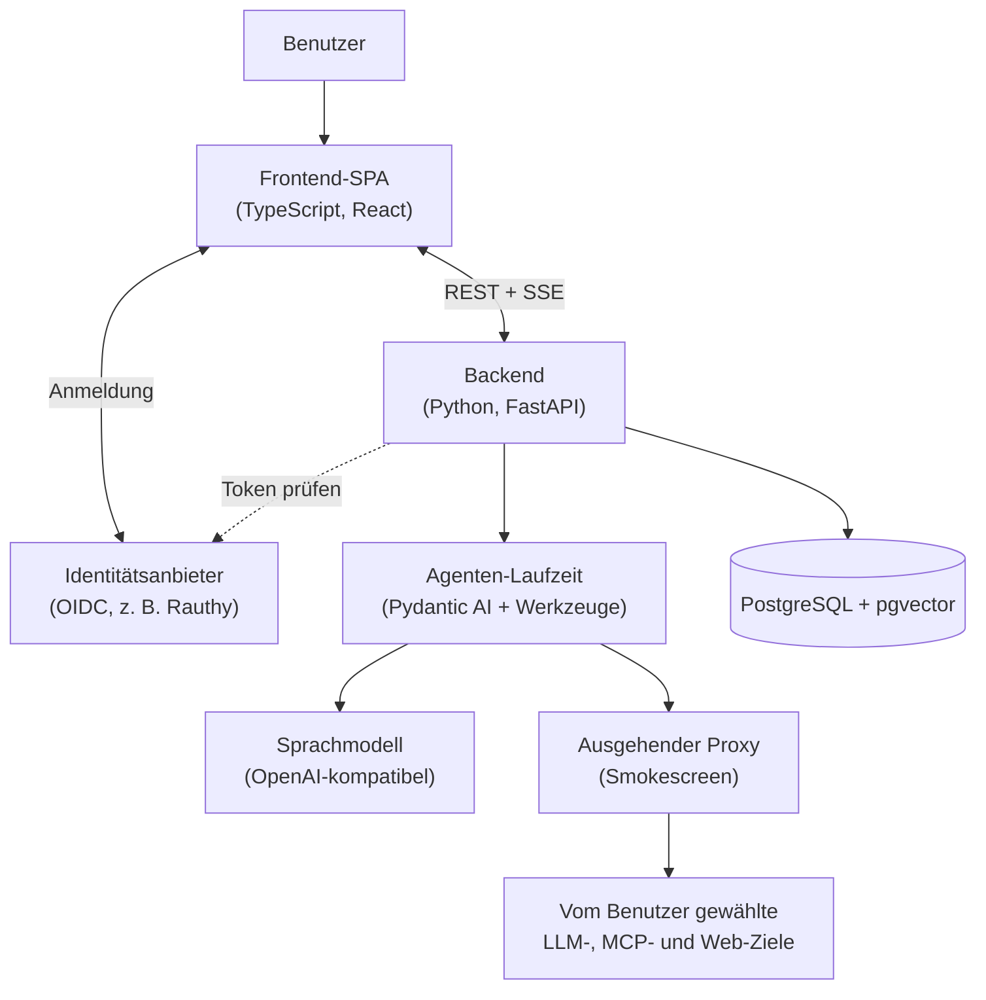

# Architektur

Hivegent besteht aus einem Browser-Frontend und einem Backend-Dienst, ergänzt durch eine Datenbank und einen Identitätsanbieter.
Das Frontend bleibt schlank, das Backend übernimmt Anmeldung, Abruf, Werkzeuge und das Sprachmodell.

## Komponenten

- Frontend: eine React-Single-Page-App für Anmeldung, Chat, Dokumente und gestreamte Antworten.
- Backend: ein FastAPI-Dienst, der jede Anfrage authentifiziert, den Agenten ausführt und den Abruf übernimmt.
- Agenten-Laufzeit: Pydantic AI, das dem Modell Werkzeuge für Suche, Lesen, Web-Abfrage, Gedächtnis und Unteragenten gibt.
- PostgreSQL mit pgvector: der einzige Datenspeicher für Dokumentenindex, Vektoren, Unterhaltungen und Gedächtnis.
  Die Dokumentdateien liegen auf der Festplatte.
- Identitätsanbieter: ein beliebiger OIDC-Dienst wie Rauthy, Keycloak oder Authentik.
  Gruppen- und Administratorrechte stammen aus den Token-Claims.
- Sprachmodell: ein beliebiger OpenAI-kompatibler Endpunkt, gehostet oder lokal.
- Ausgehender Proxy: Smokescreen führt jede vom Benutzer oder Modell gewählte Verbindung und lehnt private und reservierte Adressen ab.
  Vom Betreiber konfigurierte Dienste verbinden sich direkt.

## Schnittstellen

- REST für Dokumente, Unterhaltungen und Einstellungen.
- Chats werden über das Vercel AI Data Stream Protokoll gestreamt, der Fortschritt von Aufgaben über Server-Sent Events.
- MCP: ein optionaler Endpunkt unter `/mcp` erlaubt Editoren und anderen Agenten, mit derselben Anmeldung Dokumente zu suchen, zu lesen und zu ändern.

## Bereitstellung

Das Container-Image bündelt Backend, Frontend, den eingehenden Caddy-Proxy und den ausgehenden Smokescreen-Proxy.
Eine typische Bereitstellung besteht aus drei Containern: Hivegent, PostgreSQL und dem Identitätsanbieter.
Siehe [Einrichtung](setup.md).
