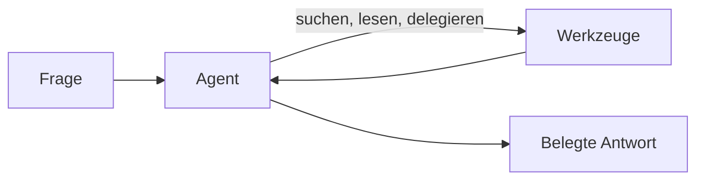

# Funktionsweise

Hivegent ist ein agentischer, abrufgestützter Assistent.

## Drei Wege, Fragen zu Dokumenten zu stellen

**Chat mit angehängten Dateien.**
Das Modell liest einige angehängte Dateien direkt.
Das skaliert nicht, da große Sammlungen nicht in den Kontext passen und es keine Suche gibt.

**Klassisches RAG.**
Eine feste Pipeline führt pro Frage eine Suche aus und antwortet aus den besten Treffern.
Das skaliert und belegt Quellen, aber verfehlt diese eine Suche ihr Ziel, kann das Modell nicht erneut suchen.

**Agentisches RAG, der Ansatz von Hivegent.**
Das Modell ist ein Agent, der selbst entscheidet, wie er die Antwort findet.
Es sucht wiederholt, liest ganze Dokumente oder einzelne Zeilen, delegiert Teilaufgaben und antwortet erst dann.
So bewältigt es vage oder mehrteilige Fragen und Antworten, die über viele Dokumente verstreut sind.

|                                 | Chat mit angehängten Dateien  | Klassisches RAG            | Agentisches RAG (Hivegent)                  |
| ------------------------------- | ----------------------------- | -------------------------- | ------------------------------------------- |
| Dokumentmenge                   | Wenige kleine Dateien         | Große Sammlungen           | Große Sammlungen                            |
| Informationssuche               | Modell liest alles Angehängte | Eine feste Suche pro Frage | Agent sucht und liest in mehreren Schritten |
| Nachfassen und Verfeinern       | Keines                        | Keines                     | Der Agent entscheidet, erneut zu suchen     |
| Quellenangaben                  | Manchmal                      | Ja                         | Ja                                          |
| Geteilte, dauerhafte Sammlungen | Nein                          | Unterschiedlich            | Ja, mit Zugriffssteuerung                   |

## Was der Assistent kann

Der Agent wählt für jede Anfrage aus diesen Werkzeuggruppen.

| Werkzeuggruppe       | Was sie dem Assistenten ermöglicht                                                                 | Verfügbarkeit                |
| -------------------- | -------------------------------------------------------------------------------------------------- | ---------------------------- |
| Suchen und Lesen     | Dokumente nach Bedeutung oder exaktem Text durchsuchen und Dokumente oder Stellen öffnen           | Immer                        |
| Berechnungen         | Ein kleines Python-Programm in einer Sandbox für Zahlen, Daten und Anzahlen ausführen              | Immer                        |
| Delegierte Erkundung | Unteragenten Dokumente, frühere Unterhaltungen oder das Web erkunden lassen                        | Immer                        |
| Unterhaltungsverlauf | Frühere Unterhaltungen direkt öffnen                                                               | Wenn vom Betreiber aktiviert |
| Gedächtnis           | Fakten für spätere Unterhaltungen speichern                                                        | Nicht im Modus Lesen         |
| Dokumentbearbeitung  | Dokumente anlegen, bearbeiten, verschieben oder löschen, im Modus Interaktiv nach Ihrer Zustimmung | Nicht im Modus Lesen         |
| Web                  | Im Web suchen und Seiten abrufen                                                                   | Wenn vom Betreiber aktiviert |
