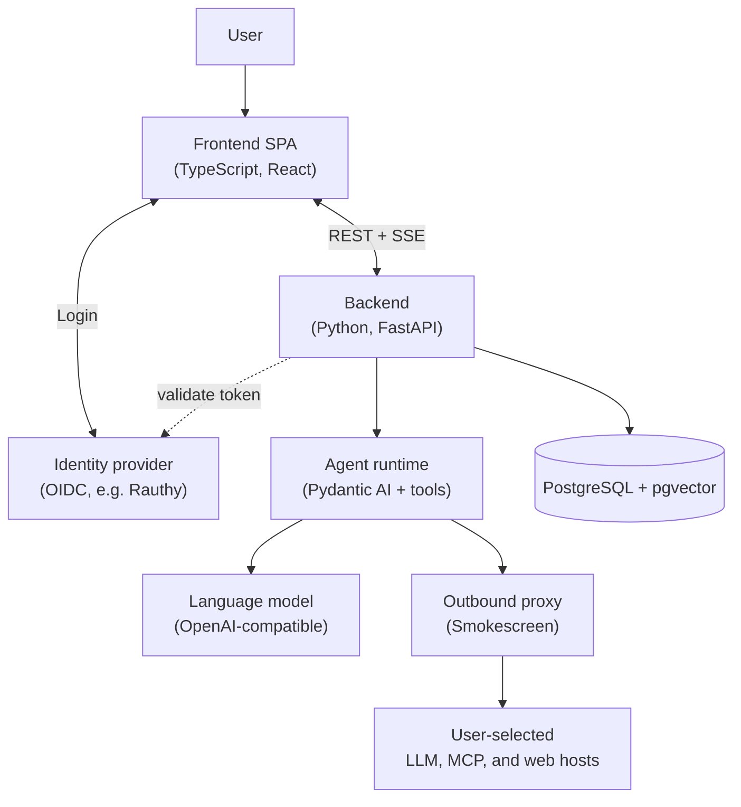

# Architecture

Hivegent is a browser frontend and a backend service, backed by a database and an identity provider.
The frontend stays thin, the backend handles login, retrieval, tools, and the language model.

## Components

- Frontend: a React single-page app for login, chat, documents, and streamed responses.
- Backend: a FastAPI service that authenticates every request, runs the agent, and performs retrieval.
- Agent runtime: Pydantic AI, which gives the model tools for search, reading, web lookup, memory, and sub-agents.
- PostgreSQL with pgvector: the only datastore, holding the document index, embeddings, conversations, and memory.
  Document files live on disk.
- Identity provider: any OIDC service such as Rauthy, Keycloak, or Authentik.
  Group and admin permissions come from the token claims.
- Language model: any OpenAI-compatible endpoint, hosted or local.
- Outbound proxy: Smokescreen carries every user or model-chosen connection and rejects private and reserved addresses.
  Operator-configured services connect directly.

## Interfaces

- REST for documents, conversations, and settings.
- Chat streams over the Vercel AI Data Stream protocol, and job progress over Server-Sent Events.
- MCP: an optional endpoint at `/mcp` lets editors and other agents search, read, and change documents with the same login.

## Deployment

The container image bundles the backend, the frontend, the Caddy inbound proxy, and the Smokescreen outbound proxy.
A typical deployment runs three containers: Hivegent, PostgreSQL, and the identity provider.
See [Setup](setup.md).
