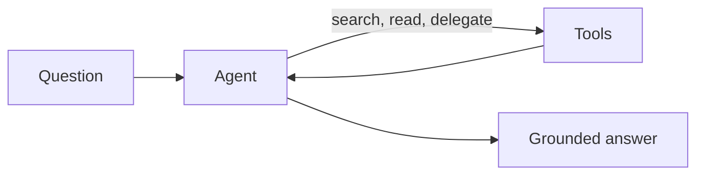

# How Hivegent Works

Hivegent is an agentic, retrieval-augmented assistant.

## Three ways to ask questions about documents

**Chat with attached files.**
The model reads a few attached files directly.
This does not scale, since large collections do not fit into the context and there is no search.

**Classical RAG.**
A fixed pipeline runs one search per question and answers from the top passages.
It scales and cites sources, but if that one search misses, the model cannot look again.

**Agentic RAG, the Hivegent approach.**
The model is an agent that decides how to find the answer.
It searches repeatedly, reads whole documents or single lines, delegates sub-tasks, and only then responds.
This handles vague or multi-part questions and answers spread across many documents.

|                                | Chat with attached files        | Classical RAG                 | Agentic RAG (Hivegent)                      |
| ------------------------------ | ------------------------------- | ----------------------------- | ------------------------------------------- |
| Document scale                 | A few small files               | Large collections             | Large collections                           |
| Finding information            | Model reads everything attached | One fixed search per question | Agent searches and reads over several steps |
| Follow-up and refinement       | None                            | None                          | The agent decides to look again             |
| Source citations               | Sometimes                       | Yes                           | Yes                                         |
| Shared, persistent collections | No                              | Varies                        | Yes, with access control                    |

## What the assistant can do

The agent picks from these toolsets for each request.

| Toolset               | What it lets the assistant do                                                   | Availability                 |
| --------------------- | ------------------------------------------------------------------------------- | ---------------------------- |
| Search and read       | Search documents by meaning or exact text and open documents or passages        | Always                       |
| Calculations          | Run a small Python program in a sandbox for numbers, dates, and counts          | Always                       |
| Delegated exploration | Let sub-agents explore documents, past conversations, or the web                | Always                       |
| Conversation history  | Open earlier conversations directly                                             | When enabled by the operator |
| Memory                | Save facts to recall in later conversations                                     | Not in Read mode             |
| Document editing      | Create, edit, move, or delete documents, with your approval in Interactive mode | Not in Read mode             |
| Web                   | Search the web and fetch pages                                                  | When enabled by the operator |
